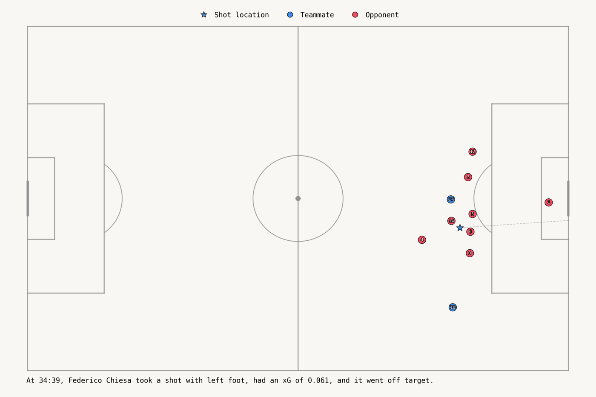
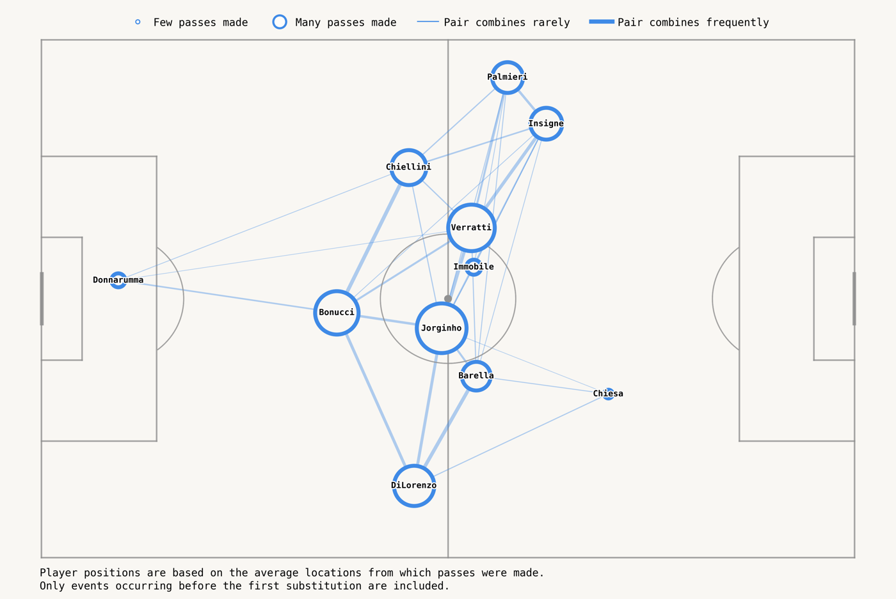
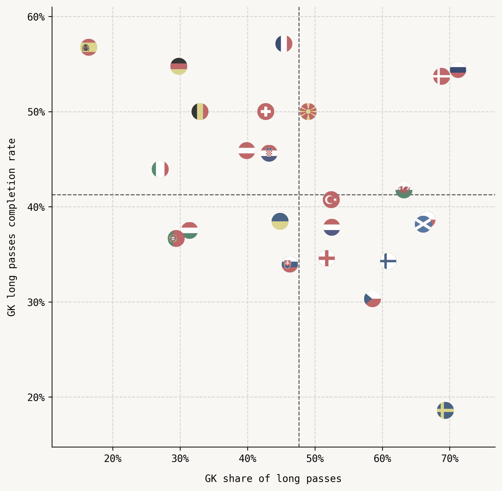
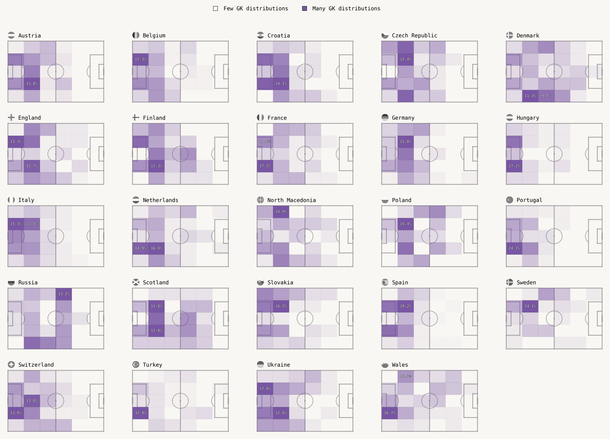
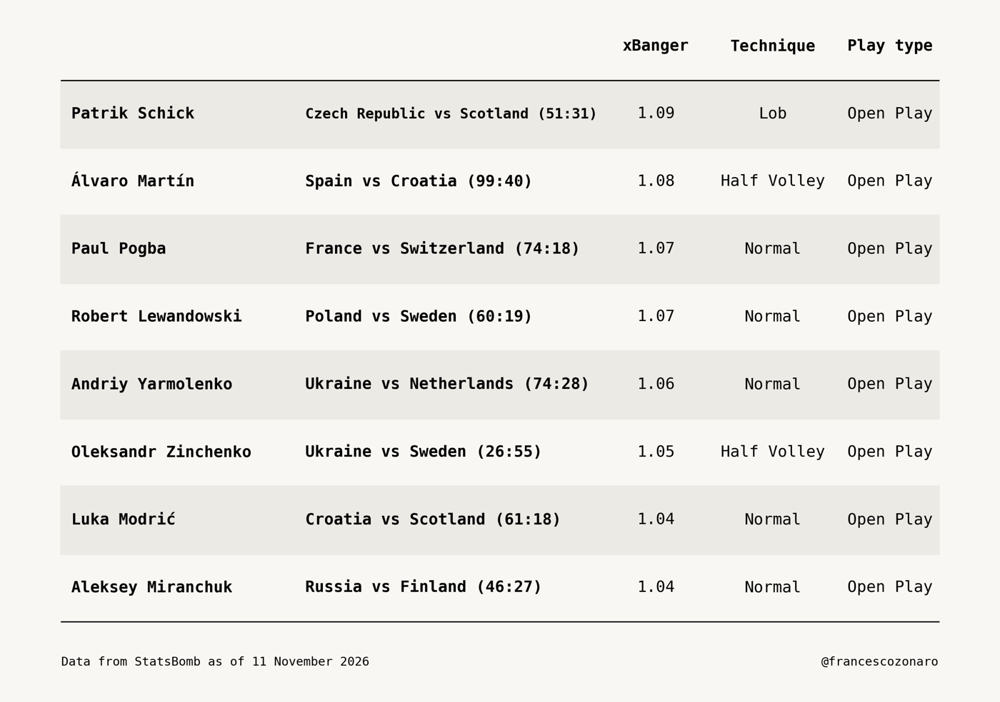

# statsbombplot

Football analytics visualizations built on [StatsBomb open data](https://github.com/statsbomb/open-data).
Passing networks, goalkeeper distribution, shot freeze frames and more, drawn with matplotlib on
a StatsBomb-coordinate pitch.

## Installation

Requires Python 3.9+.

```bash
git clone https://github.com/francescozonaro/statsbombplot.git
cd statsbombplot
python -m venv .venv && source .venv/bin/activate
pip install -e ".[dev]"
```

## Usage

Every plot is a standalone script in [`plots/`](plots). Run one from the repository root:

```bash
python plots/passing_networks.py                       # asks which match to plot
python plots/passing_networks.py --game-id 3795506     # no questions
python plots/goalkeeper_pass_completion.py --competition-id 2 --season-id 27
```

Whatever a script needs and you did not pass, it asks for, listing only what exists in the open data:
competition, then its seasons, then (for match scripts) its games with date, gameweek or stage, and score.
At any prompt, type a number to pick, or type text (a team, a year) to filter the list.
Run a script with `--help` to see its flags. Without a terminal (e.g. in CI) all flags are required.

Images are written to `output/<script_name>/`. Match data is downloaded once from the StatsBomb open data
and cached in `match_cache/`.

| Script | What it draws |
| --- | --- |
| `shot_freeze_frame.py` | Player positions at the moment of a shot (360 data) |
| `passing_networks.py` | Average positions and pass counts between players |
| `goalkeeper_pass_completion.py` | Long-pass share vs. completion rate for every team's goalkeeper |
| `goalkeeper_zonal_pass_distribution.py` | Where each team's goalkeeper distributes the ball |
| `goals_worth_watching.py` | The most spectacular goals of a season, ranked by an "xBanger" score (low xG, unusual technique, placement) |

## Team logos

Plots that show crests or flags use `src/statsbombplot/team_logos.json`, which maps each StatsBomb team name to a
[Fotmob](https://www.fotmob.com) team id (340 clubs and national teams, men's and women's). Teams missing from the
file are drawn as text, so nothing breaks. To add one, put `"Team name": <fotmob id>` in the file; the id is the number
in the team's Fotmob URL.

## Gallery

All images use EURO 2020 data (the final, Italy vs England, for the match plots).

| | |
| --- | --- |
|  |  |
|  |  |



## Project layout

```
src/statsbombplot/
  config.py        paths, colors, pitch dimensions
  cli.py           command-line flags and interactive prompts
  plotting.py      shared matplotlib helpers (style, save, grids)
  data/            StatsBomb loader, match model and cached fetching
  pitch/           pitch drawing and zone counting
plots/             one runnable script per plot
docs/images/       gallery images used in this README
tests/             unit tests (no network needed)
```

## Development

```bash
pytest          # run the tests
ruff check .    # lint
ruff format .   # format
```

## Data attribution

Data provided by [StatsBomb](https://statsbomb.com). Open data is free to use under
[StatsBomb's user agreement](https://github.com/statsbomb/open-data/blob/master/doc/StatsBomb%20Open%20Data%20Licence.pdf);
please credit StatsBomb in anything you publish.

## License

MIT, see [LICENSE](LICENSE). Third-party code is credited in [THIRD_PARTY_NOTICES.md](THIRD_PARTY_NOTICES.md).
